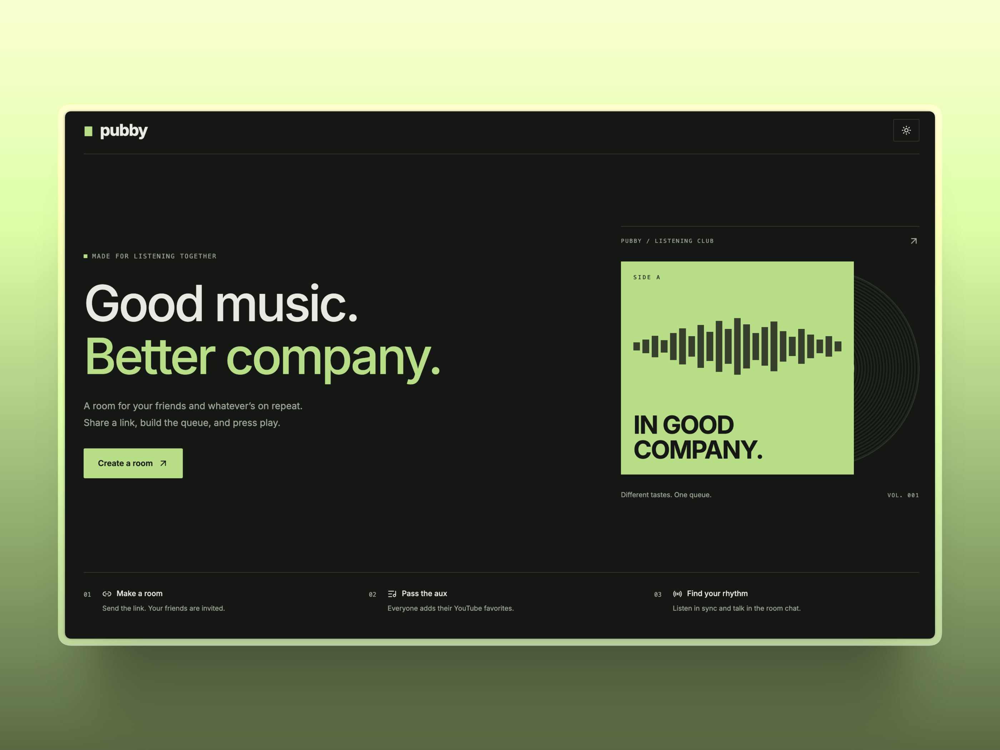

# Pubby

A minimal shared YouTube room with a flat light/dark interface. Guests can add videos, chat, see who is online, and remove their queued videos. The room creator controls play, pause, seek, skip, and queue moderation.



## Supabase setup

1. Run `supabase/migrations/202610280001_listening_rooms.sql` **once** in the project's SQL Editor.
2. Enable **Anonymous sign-ins** in Authentication → Providers. Guests receive an Auth identity without creating an email/password account.
3. Configure `NEXT_PUBLIC_SUPABASE_URL` and `NEXT_PUBLIC_SUPABASE_ANON_KEY` in `.env.local`. Never put a service-role key in these variables.
4. Run `npm install` and `npm run dev`, then create a new room.

The migration is additive and transactional. It leaves the legacy `rooms` and `video_queue` tables and their data untouched. Old room URLs are not automatically converted because those rooms have no verifiable host identity. Create a new room after the migration. Existing legacy permissions are also unchanged; archive or restrict those unused tables separately when ready.

## Schema

- `listening_rooms`: host identity, current entry, shared playback position, play/pause state, server timestamp, revision.
- `room_members`: guest identity and display name per room; heartbeat for online status.
- `queue_entries`: validated YouTube ID, author, database-generated ordering, played timestamp.
- `room_messages`: author identity and name snapshot, message body, creation time.

All four tables use RLS. Members can read their room; browser clients cannot write tables directly. Authenticated RPCs validate membership and ownership, serialize queue changes by locking the room, and reject stale playback revisions. A room URL is an invitation: anyone with it may join, but only the creator can control playback. Chat is limited to 500 characters, with a one-second per-member send interval; the client loads the latest 50 messages. Pending queues are capped at 100 videos. Room creation is limited to ten rooms per identity per hour. This is a small guest app, not a full abuse-prevention system.

## Playback and presence

Playback uses a persisted position plus a server timestamp. Clients estimate clock offset from the snapshot request and correct drift every two seconds. The custom timeline displays elapsed and total time. Hosts can drag it or use arrow keys to seek for the room, alongside play/pause and skip controls. Guests see a read-only timeline. YouTube's native control bar is hidden, but its branding, titles, ads, and other embed overlays remain controlled by YouTube. The timeline is disabled until the player reports a duration. Browsers may require a click on **Enable playback on this device** before allowing audio. Only the host advances the queue when a video ends; keep the host tab open. If the host leaves, playback may finish but automatic advancement pauses until the host returns. Host transfer and bans are not implemented.

Realtime updates refresh room snapshots immediately; a ten-second reconciliation recovers missed events and updates presence. Members disappear from the online list after 45 seconds without a heartbeat. Membership itself remains so the same guest can return. Live streams may not support precise seeking, and browsers/YouTube can introduce small playback differences. Messages and played queue entries are retained in the database; automatic retention/cleanup is not configured.

## Validation

```sh
npm run lint
npx tsc --noEmit
node --test tests/playback.test.mjs
npm run build
```

`tests/room-permissions.sql` exercises guest/host permissions, RLS, validated entries, playback revisions, advancing an empty queue, chat throttling, and renaming. Run it with `psql -v ON_ERROR_STOP=1` against a **disposable test database** after applying the migration. `tests/database-bootstrap.sql` supplies minimal Supabase Auth stand-ins for plain local PostgreSQL; never run the bootstrap on a hosted Supabase project. All test fixture data in the permission test is rolled back. Local SQL tests do not substitute for testing Supabase Auth and Realtime against the configured project after setup.

## Styling

Use Tailwind classes in components for layout, spacing, colors, and responsive states. Shared button/input classes live in `lib/ui-styles.ts` and use `cn()` to merge overrides. Keep `app/globals.css` limited to theme tokens, the Tailwind import, and base defaults. CSS modules cover the landing scene's palette/atmosphere, height-specific typography adjustment, and the create-room button text animation. Room breakpoints use 761px for the fixed-height desktop workspace; mobile keeps normal page scrolling.
