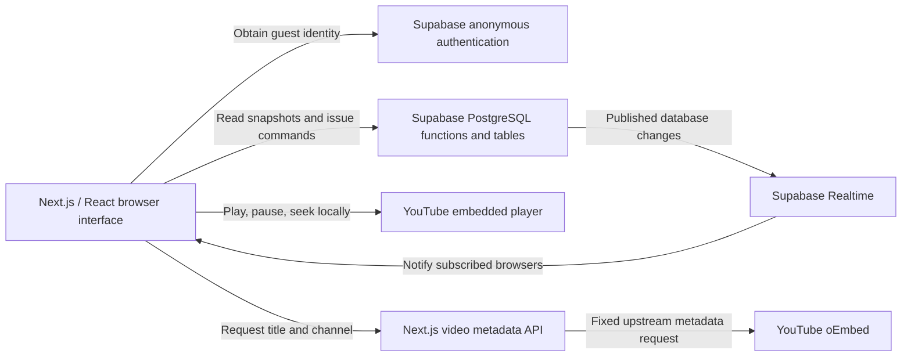
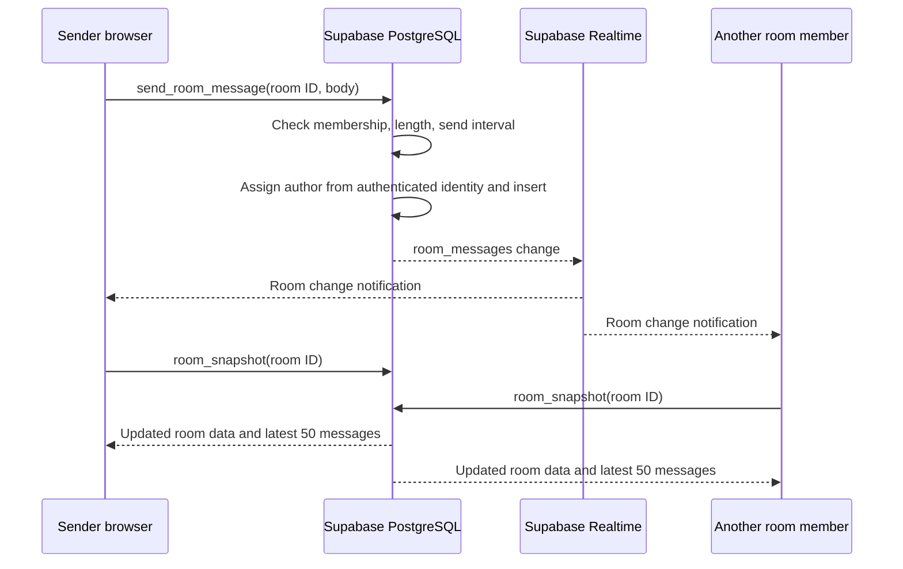

# Pubby: project structure and how it works

A guide to the current implementation, written for someone opening the repository for the first time.

## Contents

1. [What the app does](#1-what-the-app-does)
2. [The overall architecture](#2-the-overall-architecture)
3. [Folder structure](#3-folder-structure)
4. [Pages and component responsibilities](#4-pages-and-component-responsibilities)
5. [Database structure](#5-database-structure)
6. [Creating and joining rooms](#6-creating-and-joining-rooms)
7. [Shared queue and playback](#7-shared-queue-and-playback)
8. [Chat](#8-chat)
9. [Realtime updates and online status](#9-realtime-updates-and-online-status)
10. [Song titles and artist/channel names](#10-song-titles-and-artistchannel-names)
11. [Permissions and security](#11-permissions-and-security)
12. [Styling and fonts](#12-styling-and-fonts)
13. [Running and testing the project](#13-running-and-testing-the-project)
14. [Where to make changes](#14-where-to-make-changes)
15. [Current limitations](#15-current-limitations)

## 1. What the app does

Pubby lets friends share YouTube links in a room, listen together, and chat. The person who creates the room is the host. Everyone can add videos; only the host controls shared playback.

The main technologies are:

| Technology | Its job here |
| --- | --- |
| Next.js App Router | Pages, routing, shared layout, and the video metadata API |
| React and TypeScript | Interactive components, browser state, and data types |
| Supabase Auth | Anonymous guest identities without an email/password form |
| PostgreSQL through Supabase | Persistent rooms, membership, queues, messages, and permission checks |
| Supabase Realtime | Notifications when room-related database records change |
| YouTube IFrame Player API through `react-youtube` | Actual video/audio playback in each browser |
| Tailwind CSS | Component styling and responsive layouts |
| `next-themes` and Sonner | Theme switching and toast notifications |

## 2. The overall architecture

There are three separate responsibilities: the interface, shared room data, and media playback.



The browser calls Supabase directly using its public project key and the guest's authenticated session. Room commands run in PostgreSQL functions, rather than custom Next.js API endpoints.

The Next.js `/api/videos/[id]` endpoint is for public video metadata only. It does not handle room membership, chat, or playback commands.

Each browser plays its own YouTube embed. The app shares playback **state**, not a single video stream broadcast by the host.

## 3. Folder structure

```text
pubby-dj/
├── app/
│   ├── layout.tsx                    Shared fonts, theme provider, toast provider
│   ├── page.tsx                      Landing page
│   ├── globals.css                   Theme tokens and base defaults
│   ├── landing.module.css            Scenic landing-page effects
│   ├── icon.png                      App icon
│   ├── room/[id]/
│   │   ├── page.tsx                  Room route and ID-format validation
│   │   └── room-client.tsx           Room state, subscriptions, and commands
│   └── api/videos/[id]/route.ts      YouTube title/channel lookup
├── components/
│   ├── create-room-button.tsx        Guest sign-in, room creation, navigation
│   ├── create-room-button.module.css Text-swap button animation
│   ├── dismissible-details.tsx       Outside-click/Escape behavior for dropdown
│   ├── theme-provider.tsx            Theme provider and toggle
│   ├── room-navbar.tsx               Room ID, connection state, invite actions
│   ├── room-workspace.tsx            Player and Queue/Chat/People panels
│   ├── youtube-player.tsx            Embedded player, timeline, local sync
│   ├── add-video-form.tsx            Validate a YouTube link and enqueue it
│   ├── video-queue.tsx               Queue rows, thumbnails, removal controls
│   ├── video-details.tsx             Video title and artist/channel display
│   ├── room-chat.tsx                 Message list and composer
│   ├── app-sidebar.tsx               Older sidebar implementation
│   └── ui/                          Reusable UI primitives and scaffold
├── hooks/
│   ├── use-video-details.ts          Shared client-side metadata request cache
│   └── use-mobile.ts                Mobile helper used by sidebar scaffold
├── lib/
│   ├── supabase.ts                  Shared Supabase client
│   ├── room.ts                      Room types, guest identity, error helpers
│   ├── videos.ts                    YouTube URL parsing
│   ├── youtube-metadata.ts          Metadata validation and name formatting
│   ├── playback.ts                  Pure playback timing and seek helpers
│   ├── ui-styles.ts                 Shared Tailwind button/input classes
│   └── utils.ts                     Class-name merging helper
├── public/
│   ├── images/                      Landing background asset
│   └── ...                          Preview image and other static assets
├── supabase/migrations/
│   └── 202610280001_listening_rooms.sql
├── tests/
│   ├── playback.test.mjs             Playback, URL, and metadata unit tests
│   ├── database-bootstrap.sql        Local test-only Supabase Auth stand-ins
│   └── room-permissions.sql          Database authorization and behavior tests
├── docs/
│   ├── PROJECT_GUIDE.md             This guide
│   └── landing-background.md        Generated background and its prompt
├── README.md                        Quick setup and feature notes
└── package.json                     Dependencies and development commands
```

`components/app-sidebar.tsx`, `hooks/use-mobile.ts`, and several `components/ui/` files belong to the earlier sidebar scaffold. The current room uses `RoomNavbar` and `RoomWorkspace`; it does not render `AppSidebar`. The Sonner wrapper in `components/ui/sonner.tsx` is still used by the root layout.

## 4. Pages and component responsibilities

### Landing page: `/`

[app/page.tsx](../app/page.tsx) is a server component that renders the scenic background, introduction, navigation, and create-room button.

Interactive pieces are small client components:

- `CreateRoomButton` signs in the visitor anonymously and creates a room.
- `ThemeToggle` changes the selected theme.
- `DismissibleDetails` keeps the native dropdown behavior and adds outside-click/Escape dismissal.

### Room page: `/room/<room-id>`

[app/room/[id]/page.tsx](../app/room/[id]/page.tsx) checks whether the ID has UUID format. It does not fetch private room data on the server. A correctly formatted but nonexistent ID is rejected later by the database join function.

`RoomClient` obtains the browser's guest identity, joins the room, loads its data, and subscribes to changes. It owns the shared room state and passes data/callbacks into the interface.

```text
RoomPage
└── RoomClient
    ├── RoomNavbar
    └── RoomWorkspace
        ├── YouTubePlayer
        ├── AddVideoForm
        ├── VideoQueue
        │   └── VideoDetails
        ├── RoomChat
        └── People panel / display-name form
```

`RoomWorkspace` controls which side-panel tab is visible. Panels remain mounted when hidden, so switching tabs does not discard an unsent chat draft.

## 5. Database structure

The schema is defined in the [migration](../supabase/migrations/202610280001_listening_rooms.sql).

| Table | Important columns | Purpose |
| --- | --- | --- |
| `listening_rooms` | `id`, `host_id`, `current_entry_id`, `is_playing`, `playback_seconds`, `playback_updated_at`, `revision` | The room and its authoritative playback state |
| `room_members` | `room_id`, `user_id`, `display_name`, `joined_at`, `last_seen_at` | Guest membership and recent activity |
| `queue_entries` | `id`, `room_id`, `added_by`, `display_name`, `video_id`, `position`, `played_at` | Videos in playback order, including played/removed history |
| `room_messages` | `id`, `room_id`, `user_id`, `display_name`, `body`, `created_at` | Persistent chat messages |

A member is identified by the pair `(room_id, user_id)`. A person can join multiple rooms under the same anonymous Auth identity.

Queue positions are generated by PostgreSQL, rather than calculated from a browser's queue length. Commands lock the room row when changing the queue or playback, preventing concurrent commands from corrupting the ordering. The position sequence is global; gaps within an individual room are normal.

The current-entry foreign key includes the room ID, preventing a room from referencing another room's queue entry. Queue entries and messages store a snapshot of the author's display name; renaming a member does not rename their older records.

Song titles are fetched separately and are not stored in these tables.

### Database functions exposed to the app

An RPC is a remote procedure call: `supabase.rpc()` invokes a PostgreSQL function.

| Function | Purpose |
| --- | --- |
| `create_listening_room(p_name)` | Create a room and add its creator as a member/host |
| `join_listening_room(p_room, p_name)` | Join an existing room, or update an existing member's name/activity |
| `room_snapshot(p_room)` | Return room, pending queue, active members, latest messages, and server time |
| `enqueue_video(p_room, p_video)` | Add a validated video ID; start it if the room is idle |
| `control_playback(p_room, p_entry, p_revision, p_action, p_seconds)` | Host-only play, pause, seek, or skip |
| `remove_queue_entry(p_room, p_entry)` | Remove a pending video owned by the caller, or any pending video for the host |
| `send_room_message(p_room, p_body)` | Validate and save a member's message |
| `is_room_member(p_room)` | Membership helper used by policies and other functions |

## 6. Creating and joining rooms

### Creating

1. `CreateRoomButton` calls `ensureGuest()` from `lib/room.ts`.
2. An existing Supabase session is reused. Otherwise, `signInAnonymously()` creates one.
3. The button reads the display name from local storage, falling back to `Guest`.
4. It calls `create_listening_room`.
5. PostgreSQL generates the room UUID, records `auth.uid()` as the host, and creates the membership row.
6. The browser navigates to `/room/<id>`.

### Joining

1. The visitor opens an invite URL.
2. `RoomClient` obtains/reuses that browser's anonymous identity.
3. It calls `join_listening_room` with the room ID and display name.
4. The database verifies that the room exists and records the member.
5. `room_snapshot` loads the room's current data.
6. The browser subscribes to room-filtered database changes.

The invite button copies the room URL. There is no email invitation service or separate invitation-token table.

The room URL itself grants the ability to join. Once joined, a guest can read and participate in that room, but does not become its host.

## 7. Shared queue and playback

### Adding a song

```text
Paste YouTube URL
  → extractVideoId() validates the hostname and extracts an ID
  → enqueue_video RPC validates membership and inserts the entry
  → if the room was idle, this entry becomes current
  → subscribed browsers refresh their snapshots
  → each browser loads the current video in its own YouTube player
```

URL parsing supports standard watch URLs, short links, Shorts, embedded-video links, and live-video links. Queueing a valid ID does not guarantee that YouTube allows embedding that video; private, removed, restricted, or otherwise unavailable videos can still fail to play.

### Synchronizing playback

The room stores a position and the server time when that position was recorded. While playing, the target position is:

```text
expected position = stored seconds + elapsed server time
```

For example, a room stored `30 seconds` five seconds ago. A guest joining now should seek to approximately `35 seconds`. When paused, elapsed time is not added.

The browser estimates its clock offset using the snapshot's server time and the midpoint of the request's start/end timestamps. This reduces errors caused by different device clocks, but cannot remove all network jitter.

`lib/playback.ts` contains the timing calculations. `YouTubePlayer`:

- Reads player time/duration every 250 milliseconds for the timeline.
- Checks playback synchronization every two seconds.
- Normally seeks only when drift exceeds two seconds.
- Uses a smaller 0.35-second threshold when applying a new shared revision.
- Clamps seeks just inside the end of a video to avoid accidentally triggering advancement.

### Host controls and immediate feedback

The host's play/pause/seek action updates the local player immediately, then calls `control_playback`. This is an optimistic update: the UI responds before the network round trip finishes.

While that command is pending, the player uses the optimistic state instead of snapping back to the previous database state. If the command fails, it returns to the confirmed shared state. Guests follow changes after they receive the database notification or a reconciliation refresh.

Commands include the current queue-entry ID and room revision. PostgreSQL rejects stale commands. This stops a delayed end/skip event for one video from accidentally skipping the following video.

Only the host's `onEnd` event advances the queue. Removing a queued item sets its `played_at` field; it does not physically delete the row. The currently playing entry must be advanced through Skip.

## 8. Chat

[components/room-chat.tsx](../components/room-chat.tsx) handles the text draft, send state, message list, and scroll position.



Messages are sent through the database RPC over the Supabase API. Realtime is used to notify listeners of the saved database change; it is not a separate peer-to-peer chat transport.

Important details:

- Enter sends; Shift+Enter inserts a new line. IME composition is not submitted by Enter.
- The textarea becomes read-only while sending, rather than disabled, so it keeps keyboard focus.
- The server enforces 1–500 characters and a one-second interval per member within a room.
- The server assigns the sender's identity and name; the client supplies only the room ID and body.
- The latest 50 messages are loaded in chronological order. Older messages remain stored, but pagination is not implemented.
- New messages scroll into view when the reader is near the bottom. Reading earlier messages does not automatically force the view to the bottom.

## 9. Realtime updates and online status

`RoomClient` subscribes to `postgres_changes` on:

- `listening_rooms`, filtered by `id`;
- `queue_entries`, filtered by `room_id`;
- `room_messages`, filtered by `room_id`.

On a notification, the app fetches a fresh **whole-room snapshot** rather than trying to merge that individual event into the existing state. This keeps rendering straightforward, at the cost of extra reads as room activity grows.

It also refreshes after subscription, every ten seconds, and when the browser window gains focus. These refreshes help recover events missed during connection loss. Older in-flight responses are ignored when a newer refresh has started.

### Online count

Every snapshot request updates that guest's `last_seen_at`. The snapshot includes members seen within the last 45 seconds. The UI derives its online count from that list.

This is heartbeat-based presence; it does not use Supabase's separate Realtime Presence API. Someone leaving may remain counted briefly, and membership itself is retained after their online status expires. The Leave action navigates home; it does not delete membership or transfer the host role.

## 10. Song titles and artist/channel names

Metadata takes a separate path from playback:

```text
VideoDetails / RoomWorkspace
  → useVideoDetails(video ID)
  → GET /api/videos/<id>
  → YouTube's fixed public oEmbed endpoint
  → validated title + uploader/channel name
```

The server endpoint rejects invalid IDs and constructs its own YouTube URL. It does not accept an arbitrary upstream URL. It returns plain metadata, not the HTML embed supplied by oEmbed.

Caching and fallbacks:

| Layer | Behavior |
| --- | --- |
| Server upstream fetch | Successful responses are configured for 24-hour revalidation; five-second request timeout |
| API success response | One-hour public cache, with stale-while-revalidate |
| Browser hook | Reuses in-flight requests and successful lookups for one hour; cache capped at 256 entries |
| Failed client lookup | Can retry after one minute while the component remains mounted |
| Missing metadata | Generic YouTube labels; playback remains usable |

YouTube's `author_name` is the uploader/channel, not a verified recording artist. The formatter removes an auto-generated ` - Topic` suffix for display, but does not attempt to invent or infer artist credits from a video title.

No YouTube API key or schema change is required for this lookup.

## 11. Permissions and security

Anonymous guests still have an authenticated Supabase identity. They use the `authenticated` database role; this is different from making requests with only the public project key and no signed-in user.

The migration uses several layers:

1. **Row Level Security (RLS):** members can select rows belonging to rooms they have joined.
2. **Table grants:** browser roles do not receive direct insert/update/delete privileges on the four new tables.
3. **RPC validation:** database functions check membership, host ownership, inputs, and stale revisions before mutating data.
4. **Restricted function execution:** the new functions are granted to `authenticated`, not unauthenticated callers.

These functions use `SECURITY DEFINER`, so they execute with their owner's privileges. Their explicit checks are essential; RLS alone is not the authorization layer for those function bodies. The migration also sets an empty search path and uses schema-qualified references.

Current limits include a 100-video pending queue and a ten-rooms-per-identity-per-hour creation check. These are basic application limits, not comprehensive abuse prevention.

The public metadata API does not expose private room data and does not require a guest session. Its upstream URL is fixed and its input is limited to a YouTube video ID.

The migration does not change permissions on legacy `rooms` or `video_queue` tables. Those earlier tables are not used by the current room flow and must be reviewed separately if still present in a hosted project.

## 12. Styling and fonts

- `app/globals.css`: Tailwind import, theme variables, font mappings, and base defaults.
- Tailwind classes beside component markup: layout, spacing, colors, responsive behavior, selected tabs, and other visual states.
- `lib/ui-styles.ts`: shared button and input class strings.
- `cn()` in `lib/utils.ts`: combines class names and resolves conflicting Tailwind utilities.
- `app/landing.module.css`: scoped landscape palette, image treatment, and a short-desktop adjustment.
- `components/create-room-button.module.css`: the text-only hover animation.

The root layout loads Inter and Instrument Serif through `next/font/google`. Inter is the default `font-sans`; Instrument Serif is available through `font-serif` on selected elements. Loading a font variable makes it available without applying it to every element.

`next-themes` adds/removes the `dark` class and saves theme preference. The room's desktop layout starts at 761px and uses `100dvh`, with internal panel scrolling. Mobile uses normal page scrolling.

## 13. Running and testing the project

### Local setup

Create `.env.local` with these variable names and your project's public values:

```dotenv
NEXT_PUBLIC_SUPABASE_URL=<your-project-url>
NEXT_PUBLIC_SUPABASE_ANON_KEY=<your-public-anon-key>
```

The public key is expected to be available to browsers. Never put a service-role key in a `NEXT_PUBLIC_` variable.

In Supabase:

1. Apply the migration once in the SQL Editor.
2. Enable Anonymous sign-ins under Authentication settings.
3. Ensure the migration's Realtime publication changes succeeded.

Then run:

```sh
npm install
npm run dev
```

For a production build and local production server:

```sh
npm run build
npm run start
```

### Checks

```sh
npm run lint
npx tsc --noEmit
node --test tests/playback.test.mjs
npm run build
```

| Test file | What it checks |
| --- | --- |
| `tests/playback.test.mjs` | Playback timing, seek boundaries, timestamp labels, URL parsing, metadata validation, and redundant-seek prevention |
| `tests/room-permissions.sql` | Guest/host permissions, room visibility, queue behavior, stale commands, chat throttling, and name updates |
| `tests/database-bootstrap.sql` | Test-only roles/Auth stand-ins for a disposable plain PostgreSQL database |

Run SQL tests with `psql -v ON_ERROR_STOP=1` against a disposable test database after applying the migration. Do not run the bootstrap on hosted Supabase. The permission test rolls back its fixture data.

These tests do not replace a two-browser check of real Supabase Auth, Realtime, and YouTube playback. Use a normal browser for the host and incognito or another browser profile for the guest. Two incognito windows can share the same identity.

### Common setup issues

| Symptom | Check |
| --- | --- |
| Guest sign-in fails | Anonymous sign-ins are enabled in Supabase |
| A room RPC cannot be found | The migration succeeded in the same project configured in `.env.local` |
| Changes arrive only after several seconds | Realtime publication, connection status, and network; the ten-second fallback may be doing the updates |
| Video will not start with sound | Click Enable playback on this device to satisfy the browser's interaction requirement |
| New styles appear missing | Restart the dev server and force-refresh before assuming the markup is wrong |

## 14. Where to make changes

| You want to change… | Start here |
| --- | --- |
| Landing copy/layout | `app/page.tsx` |
| Landing background treatment | `app/landing.module.css`, `public/images/` |
| Default fonts/theme tokens | `app/layout.tsx`, `app/globals.css` |
| Create-room behavior | `components/create-room-button.tsx`, `create_listening_room` RPC |
| Invite button or room navbar | `components/room-navbar.tsx` |
| Room fetching/subscriptions | `app/room/[id]/room-client.tsx` |
| Queue/Chat/People tabs | `components/room-workspace.tsx` |
| Video controls or drift correction | `components/youtube-player.tsx`, `lib/playback.ts` |
| Accepted YouTube links | `lib/videos.ts` |
| Queue appearance | `components/video-queue.tsx`, `components/video-details.tsx` |
| Song metadata lookup | `hooks/use-video-details.ts`, `app/api/videos/[id]/route.ts` |
| Chat interface | `components/room-chat.tsx` |
| Permissions, persistence, host ownership | A new migration under `supabase/migrations/` |

For changes to an already deployed database, add a new migration instead of assuming that editing the original SQL file changes Supabase. UI-only changes normally need no migration.

## 15. Current limitations

- Host transfer and automatic host failover are not implemented. If the host leaves, guests cannot take over controls, and automatic queue advancement stops.
- Guests depend on their anonymous session. Clearing browser data can lose access to the identity that owns a room.
- There are no saved playlists, account profiles, bans, message deletion, or older-message pagination.
- The app reloads whole-room snapshots on changes; this is deliberately simple but is not optimized for very large or very busy rooms.
- Database records are retained; automatic cleanup/retention is not configured.
- Video metadata is displayed separately and is not stored with queue entries.
- YouTube controls titles, branding, related videos, caption preferences, availability, and buffering. The custom timeline does not replace the underlying iframe or make its overlays removable.
- Playback correction is approximate, not sample-accurate. Network latency, live streams, browser autoplay rules, and YouTube behavior can create differences between listeners.
